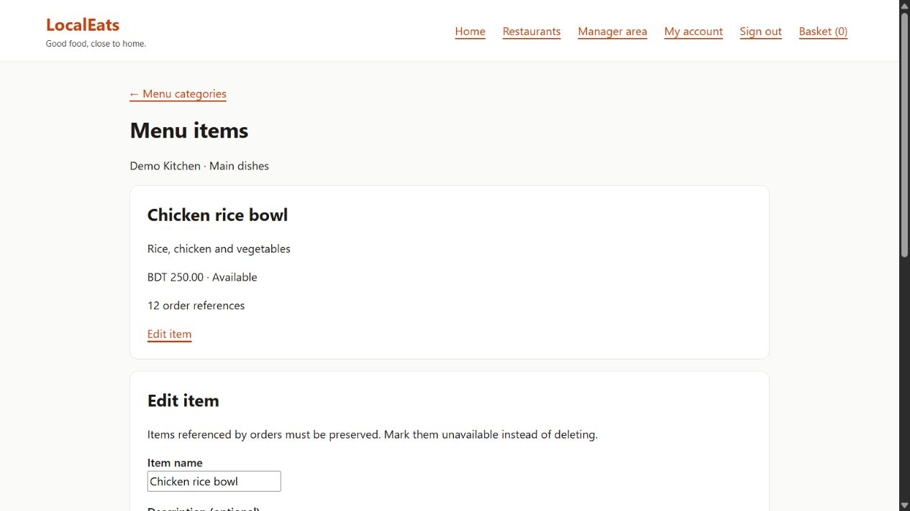
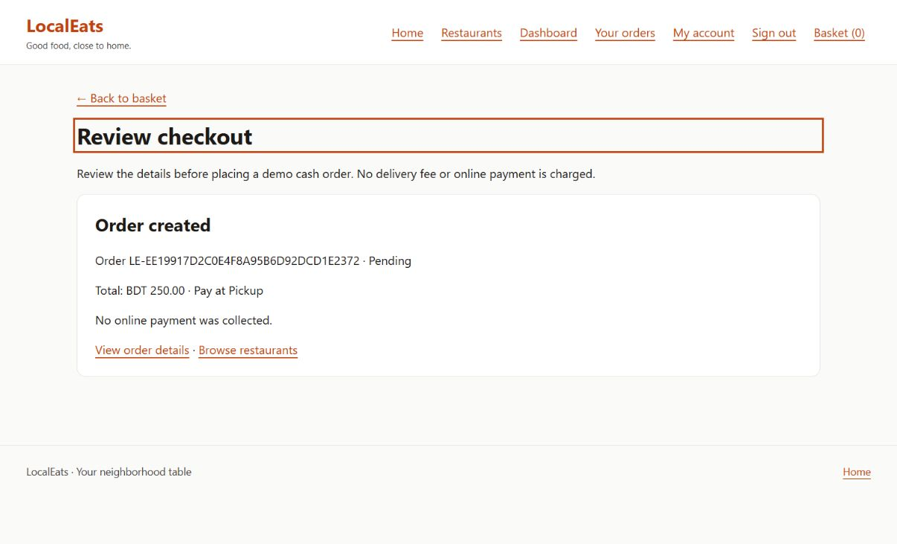
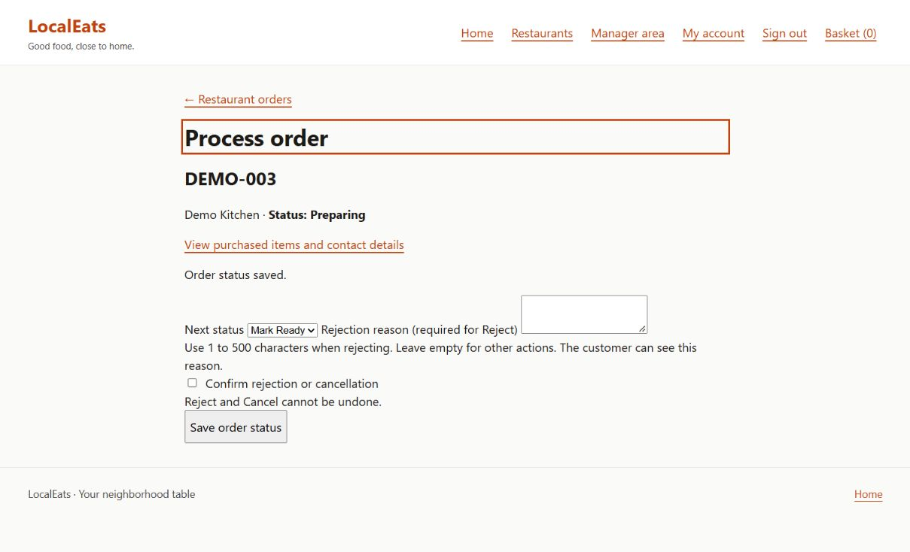

# LocalEats

A C# food-ordering application for customers and restaurant managers.

LocalEats brings together restaurant browsing, basket management, checkout and restaurant operations in one application. The project focuses on clear business rules, secure access to restaurant data and reliable database updates.

This repository presents a portfolio overview of the product, its architecture and the work completed so far.

## What the application does

| Area | Implemented features |
| --- | --- |
| Customer | Registration, login, account details, restaurant search, menus, basket, cash/pickup checkout and order history |
| Restaurant Manager | Assigned-restaurant access, profile editing, menu categories, menu items, incoming orders and order processing |
| Order processing | Accept, reject with a reason, prepare, mark ready, complete and cancel where permitted |
| Reliability | Saved purchase prices, duplicate-order protection, stale-update checks and transactional audit records |

The Admin area is the next development phase. Restaurant approval, user administration and an audit-log viewer are planned.

## Technology

- **Language:** C#
- **Web application:** ASP.NET Core and Blazor Web App
- **Database:** PostgreSQL
- **Data access:** Entity Framework Core with Npgsql
- **Authentication:** ASP.NET Core Identity
- **Testing:** xUnit with HTTP and PostgreSQL integration tests
- **Development:** VS Code, Docker Compose, Git and GitHub Actions

## Selected screens

The screenshots use disposable demonstration data.

### Menu management

Managers can maintain dishes, prices and availability. Items referenced by historical orders are protected from deletion.

### Customer checkout

Checkout validates details and prices on the server before creating an order. The current payment options are cash on delivery and pay at pickup.

### Restaurant order processing

Managers can only process orders belonging to their assigned restaurant. Each successful status change now saves an audit record in the same database transaction.

## Engineering work

- Separated presentation, application rules, domain models and database access.
- Enforced role checks and restaurant ownership on the server.
- Stored money in integer minor units and retained purchased item names and prices.
- Used database migrations for schema changes.
- Prevented competing or repeated updates from overwriting an order's current state.
- Made order-status updates and their audit records commit together or roll back together.
- Verified critical workflows against PostgreSQL, including a forced database-write failure.

The latest local verification passed **439 automated tests**, with no skipped tests, build warnings or build errors. Automated browser flows and deployment remain future work.

## Read more

- [Architecture](docs/ARCHITECTURE.md)
- [Testing and reliability](docs/TESTING.md)
- [Development roadmap](docs/ROADMAP.md)
