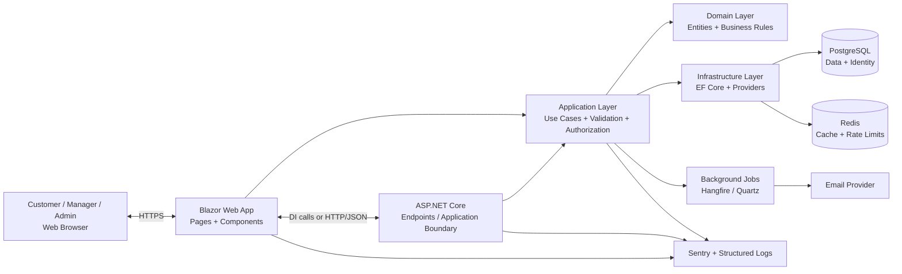

# System Architecture

## LocalEats - Food Ordering Platform

This document describes the overall system architecture, technology stack, folder structure, data flow, and key design decisions for the LocalEats application.

LocalEats is a light, C#-first food-ordering platform with three primary actor areas:

- Customer.
- Restaurant Manager.
- Platform Administrator.

The application is intentionally designed as a modular monolith so the fundamentals are easy to understand, test, and extend.

---

## 1. High-Level Architecture

LocalEats follows a modular full-stack architecture using Blazor, ASP.NET Core, Entity Framework Core, and PostgreSQL.



### Main request path

```text
User
  ↓
Blazor page or component
  ↓
Form/request validation
  ↓
ASP.NET Core endpoint or application service
  ↓
Authentication check
  ↓
Authorization and resource-ownership check
  ↓
Application use case
  ↓
Domain business rules
  ↓
EF Core
  ↓
PostgreSQL transaction
  ↓
Application result
  ↓
Blazor UI or API response
```

### Important architectural decision

For the initial MVP, Blazor pages may call application services through dependency injection. An API boundary is also included for stable HTTP contracts and future clients. Both paths must use the same application services so business logic is never duplicated.

---

## 2. Technology Stack

Technologies used in the project and their purpose.

| Layer | Technology | Purpose |
|---|---|---|
| Frontend | Blazor Web App | C#-based user interface |
| Language | C# | Application, UI, and domain development |
| Runtime | .NET LTS | Runtime and standard libraries |
| Backend | ASP.NET Core | Web server, dependency injection, middleware, endpoints |
| API | ASP.NET Core endpoints/controllers | HTTP and JSON application boundary |
| Domain | C# class library | Entities, value objects, and business rules |
| Application | C# class library | Use cases, validation, authorization, DTO mapping |
| Database | PostgreSQL | Relational data storage |
| ORM | Entity Framework Core | Database queries, change tracking, and migrations |
| Provider | Npgsql | PostgreSQL integration for EF Core |
| Authentication | ASP.NET Core Identity | User accounts, passwords, cookies, and roles |
| Validation | FluentValidation | Server-side request and command validation |
| Background jobs | Hangfire or Quartz.NET | Emails and retryable slow operations |
| Cache/rate limiting | Redis | Shared cache and distributed request limits |
| Logging | Serilog | Structured application logs and request IDs |
| Error tracking | Sentry or approved equivalent | Production exception tracking |
| Testing | xUnit + FluentAssertions | Unit and application tests |
| Integration testing | Testcontainers PostgreSQL | Tests against real PostgreSQL behavior |
| Browser testing | Playwright | End-to-end customer and manager flows |
| API documentation | OpenAPI/Swagger | Endpoint documentation and testing |
| Version control | Git + GitHub | Source control, branches, pull requests, and CI |
| CI/CD | GitHub Actions | Automated build, tests, and deployment checks |
| Local services | Docker Compose | Reproducible local PostgreSQL and optional Redis |
| Hosting | Azure App Service, container host, or approved provider | Application deployment |
| Database hosting | Managed PostgreSQL | Backups, availability, and production database operations |

### Stack constraints

- Do not replace an approved technology without an architecture decision record.
- Do not introduce a JavaScript frontend for the MVP.
- Do not introduce microservices or Kubernetes before measured need.
- Do not put database provider code in the Domain or Application projects.
- Do not use floating-point values for money; store integer minor units such as `long TotalMinor`.

---

## 3. Folder Structure

The project follows a layered and feature-oriented structure to keep the code organized and scalable.

```text
LocalEats/
├── LocalEats.sln
├── AGENTS.md
├── README.md
├── .env.example
├── .gitignore
├── .editorconfig
├── global.json
├── Directory.Build.props
├── Directory.Packages.props
├── docker-compose.yml
│
├── src/
│   ├── LocalEats.Web/
│   │   ├── Components/
│   │   │   ├── Layout/
│   │   │   ├── Shared/
│   │   │   └── Forms/
│   │   ├── Pages/
│   │   │   ├── Customer/
│   │   │   ├── Manager/
│   │   │   └── Admin/
│   │   ├── Services/
│   │   │   └── ApiClients/
│   │   ├── State/
│   │   ├── wwwroot/
│   │   ├── App.razor
│   │   ├── Routes.razor
│   │   └── Program.cs
│   │
│   ├── LocalEats.Api/
│   │   ├── Endpoints/
│   │   │   ├── RestaurantEndpoints.cs
│   │   │   ├── MenuEndpoints.cs
│   │   │   ├── OrderEndpoints.cs
│   │   │   └── AdminEndpoints.cs
│   │   ├── Middleware/
│   │   │   ├── ExceptionHandlingMiddleware.cs
│   │   │   └── RequestIdMiddleware.cs
│   │   ├── Filters/
│   │   ├── OpenApi/
│   │   └── Program.cs
│   │
│   ├── LocalEats.Application/
│   │   ├── Common/
│   │   │   ├── Interfaces/
│   │   │   ├── Results/
│   │   │   ├── Errors/
│   │   │   └── Behaviors/
│   │   ├── Restaurants/
│   │   │   ├── Commands/
│   │   │   ├── Queries/
│   │   │   ├── Validators/
│   │   │   └── Dtos/
│   │   ├── Menu/
│   │   ├── Orders/
│   │   ├── Users/
│   │   ├── Admin/
│   │   └── DependencyInjection.cs
│   │
│   ├── LocalEats.Domain/
│   │   ├── Entities/
│   │   │   ├── ApplicationUser.cs
│   │   │   ├── Restaurant.cs
│   │   │   ├── MenuCategory.cs
│   │   │   ├── MenuItem.cs
│   │   │   ├── Order.cs
│   │   │   └── OrderItem.cs
│   │   ├── Enums/
│   │   ├── ValueObjects/
│   │   ├── Events/
│   │   ├── Exceptions/
│   │   └── Rules/
│   │
│   ├── LocalEats.Infrastructure/
│   │   ├── Persistence/
│   │   │   ├── LocalEatsDbContext.cs
│   │   │   ├── Configurations/
│   │   │   ├── Migrations/
│   │   │   ├── Repositories/
│   │   │   └── Seed/
│   │   ├── Identity/
│   │   ├── Email/
│   │   ├── BackgroundJobs/
│   │   ├── Caching/
│   │   ├── Files/
│   │   ├── Logging/
│   │   └── DependencyInjection.cs
│   │
│   └── LocalEats.Contracts/
│       ├── Restaurants/
│       ├── Menu/
│       ├── Orders/
│       ├── Users/
│       └── Common/
│
├── tests/
│   ├── LocalEats.Domain.Tests/
│   ├── LocalEats.Application.Tests/
│   ├── LocalEats.Api.Tests/
│   └── LocalEats.E2E.Tests/
│
└── docs/
    ├── PRD.md
    ├── ARCHITECTURE.md
    ├── DESIGN.md
    ├── RULES.md
    ├── TASKS.md
    ├── TEST_PLAN.md
    ├── SECURITY.md
    ├── PERMISSIONS.md
    ├── MEMORY.md
    └── decisions/
```

### Folder organization rule

Keep related code together by feature inside the Application, Contracts, and Web projects. For example:

```text
LocalEats.Application/Orders/
├── Commands/
├── Queries/
├── Validators/
├── Dtos/
└── OrderService.cs
```

Do not put every class in one global `Helpers`, `Services`, or `Managers` folder.

---

## 4. Project Responsibilities

### 4.1 `LocalEats.Web`

Responsible for:

- Blazor pages and components.
- Layouts and navigation.
- Forms and UI state.
- Customer, manager, and admin screens.
- Calling application services or API clients.
- Loading, empty, error, and success states.

Must not contain:

- Direct `DbContext` usage.
- Raw SQL.
- Database connection strings.
- Secret keys.
- Core order, pricing, or authorization rules.

### 4.2 `LocalEats.Api`

Responsible for:

- HTTP endpoints.
- Request and response mapping.
- Authentication context extraction.
- HTTP status codes.
- API middleware.
- OpenAPI documentation.

Endpoints must remain thin: validate input, identify the user, call an application service, and map the result.

### 4.3 `LocalEats.Application`

Responsible for:

- Use cases such as `CreateOrder`, `UpdateMenuItem`, and `ApproveRestaurant`.
- Workflows that coordinate multiple domain objects.
- Permission and ownership checks.
- FluentValidation validators.
- DTOs and result types.
- Interfaces for infrastructure services.

This project must not depend on PostgreSQL-specific classes.

### 4.4 `LocalEats.Domain`

Responsible for:

- Entities.
- Enums and value objects.
- Invariants that must always be true.
- Order status transition rules.
- Domain events where useful.

The Domain project must not depend on UI, HTTP, EF Core, or external providers.

### 4.5 `LocalEats.Infrastructure`

Responsible for:

- EF Core `DbContext`.
- Entity configurations.
- PostgreSQL migrations.
- Repository and query implementations.
- Identity persistence.
- Email, storage, cache, and background-job integrations.
- Logging and external provider setup.

### 4.6 `LocalEats.Contracts`

Responsible for:

- Request models.
- Response models.
- Shared error contracts.
- Public API shapes.

Do not place EF Core entities in Contracts.

---

## 5. How Different Parts Connect

### 5.1 Blazor page to database

```text
Restaurant.razor
  ↓
IRestaurantService
  ↓
RestaurantService
  ↓
IRestaurantRepository
  ↓
RestaurantRepository
  ↓
LocalEatsDbContext
  ↓
Npgsql
  ↓
PostgreSQL
```

Blazor displays data and collects user input. The Application service performs the use case. Infrastructure performs persistence.

### 5.2 Blazor page through API

```text
Order.razor
  ↓
OrderApiClient
  ↓ HTTPS/JSON
POST /api/orders
  ↓
OrderEndpoint
  ↓
IOrderService
  ↓
PostgreSQL transaction
```

Use this path when an independent HTTP client is needed. Do not implement order logic separately in the endpoint and the Blazor page.

### 5.3 Dependency injection

`Program.cs` registers each layer:

```csharp
builder.Services.AddApplication();
builder.Services.AddInfrastructure(builder.Configuration);
builder.Services.AddWebServices();
```

Infrastructure registration includes:

- `LocalEatsDbContext`.
- Repositories.
- ASP.NET Core Identity.
- Email provider.
- Background-job processor.
- Redis cache and rate limiter.
- Storage provider.

### 5.4 Request and data flow: create order

```text
Customer submits checkout
  ↓
CreateOrderRequest
  ↓
Authentication check
  ↓
FluentValidation
  ↓
Load current menu prices from PostgreSQL
  ↓
Check item availability
  ↓
Recalculate totals on server
  ↓
Create Order and OrderItem snapshots
  ↓
Save in one EF Core transaction
  ↓
Queue confirmation notification
  ↓
Return OrderSummary
  ↓
Navigate to confirmation page
```

### 5.5 Request and data flow: manager status update

```text
Manager clicks Accept
  ↓
UpdateOrderStatusRequest
  ↓
Manager policy check
  ↓
Restaurant ownership check
  ↓
Order transition rule
  ↓
Update order and create audit event
  ↓
Commit transaction
  ↓
Return updated order
  ↓
Refresh manager dashboard
```

---

## 6. Authentication and Authorization Flow

```text
Login form
  ↓
ASP.NET Core Identity
  ↓
Authentication cookie/session
  ↓
HttpContext.User
  ↓
Role or policy authorization
  ↓
Resource ownership check
  ↓
Application service
```

Roles:

```text
Customer
Manager
Admin
```

Use two authorization levels:

1. Policy authorization: whether the user has the required capability.
2. Resource authorization: whether the user can access this restaurant, order, or menu item.

The UI may hide unavailable controls, but the server must enforce every permission. Cross-user or cross-restaurant access must not be possible by changing an ID in a URL.

---

## 7. Database Connection and Persistence Rules

```text
Application service
  ↓
Repository interface
  ↓
Repository implementation
  ↓
LocalEatsDbContext
  ↓
EF Core LINQ
  ↓
Npgsql provider
  ↓
PostgreSQL
```

Rules:

- Every schema change uses an EF Core migration.
- Every customer order query scopes by customer ID.
- Every manager query scopes by assigned restaurant.
- Every admin operation uses an explicit admin policy.
- Lists use pagination.
- Read-only queries use `AsNoTracking()` where appropriate.
- List queries project to DTOs rather than loading unnecessary entities.
- Foreign keys and common filters have indexes.
- Order creation uses a transaction.
- Historical order items preserve purchased name and price.
- Seed data runs only in development or explicit test environments.

---

## 8. Error Handling and Observability

```text
Validation or exception
  ↓
Application result or global middleware
  ↓
Structured log with request ID
  ↓
Friendly UI/API response
  ↓
Sentry event for unexpected failure
```

Use consistent error categories:

```text
ValidationError
Unauthorized
Forbidden
NotFound
Conflict
UnexpectedError
```

API error shape:

```json
{
  "error": {
    "code": "VALIDATION_ERROR",
    "message": "The request is invalid.",
    "requestId": "req_123",
    "fields": {
      "phoneNumber": "A valid phone number is required."
    }
  }
}
```

Never return stack traces, SQL, connection strings, tokens, or passwords to users. Logs must redact passwords, cookies, authorization headers, payment details, and sensitive personal data.

---

## 9. Background Jobs and External Services

```text
Application service commits business data
  ↓
Queue idempotent job
  ↓
Hangfire or Quartz worker
  ↓
Email/storage/payment provider
  ↓
Retry transient failure
  ↓
Record final failure for inspection
```

Use background jobs for:

- Order confirmation emails.
- Rejection and cancellation notifications.
- Password-reset emails when applicable.
- Retryable external notifications.
- Future payment webhook follow-up work.

Jobs must be idempotent. Replaying a job must not duplicate an order, payment, or notification.

---

## 10. Frontend State Flow

Every data-driven page must model:

```text
Initial
  ↓
Loading
  ↓
Success ──→ Empty, when no records exist
  ↓
Error, when the request fails
```

Every form must model:

```text
Editing
  ↓
Submitting
  ↓
Validation error
  ↓
Server error
  ↓
Success
```

Feature-specific state belongs near the feature. Reusable controls belong in `Components/Shared`.

---

## 11. Deployment Architecture

### Local development

```text
Browser
  ↓
ASP.NET Core / Blazor application
  ├── Docker PostgreSQL
  ├── Optional Docker Redis
  └── Local email/test provider
```

### Preview and production

```text
Browser
  ↓ HTTPS
Hosted ASP.NET Core / Blazor application
  ├── Managed PostgreSQL
  ├── Email provider
  ├── Redis, when enabled
  ├── Private object storage, when enabled
  └── Sentry / structured log destination
```

Environment flow:

```text
Local development → Preview/Staging → Production
```

Each environment must use:

- A separate database.
- Separate authentication configuration.
- Separate provider keys.
- Environment-specific connection strings.
- Health checks.
- Automated backups in production.

Never commit `.env`, passwords, database URLs, or provider secrets.

---

## 12. Dependency Rules

```text
Domain
  ↓
Application
  ↓
Infrastructure

Web ───────────────→ Application and Contracts
Api ───────────────→ Application and Contracts
Infrastructure ───→ Application and Domain
```

Rules:

1. Domain references no other LocalEats project.
2. Application references Domain, never Infrastructure.
3. Infrastructure implements interfaces declared by Application.
4. Web and Api do not access `DbContext` directly.
5. Contracts contain transport models, not persistence models.
6. Test projects may reference the projects they test.
7. External services are accessed through interfaces where they affect business workflows.
8. Do not create a second database access layer.
9. Do not create circular project references.

---

## 13. Build Order

1. Create the solution and project references.
2. Add configuration and health checks.
3. Add PostgreSQL and EF Core migrations.
4. Add Identity and roles.
5. Add domain entities and order rules.
6. Build restaurant browsing.
7. Build menu browsing.
8. Build basket and checkout.
9. Build customer order history.
10. Build manager menu and order workflows.
11. Build admin approval and audit logging.
12. Add integration and browser tests.
13. Add logging, error tracking, rate limiting, and measured caching.
14. Add payment only after the core order flow is reliable.
15. Deploy preview, run QA, and deploy production.

---

## 14. Architecture Definition of Done

The architecture is correctly implemented when:

- The solution builds with `dotnet build`.
- The test suite runs with `dotnet test`.
- Web components do not query the database directly.
- Application services contain use-case logic.
- Infrastructure contains EF Core and provider code.
- All database changes have migrations.
- Authentication and resource ownership are checked server-side.
- Order creation is transactional.
- API and UI errors are consistent and safe.
- The health endpoint reports application and database status.
- Background jobs are retryable and idempotent.
- Preview and production use separate configuration and databases.
- The folder structure and dependency rules remain documented here.

### Restaurant foundation (TASK-015)

Restaurant persists the existing IsApproved/IsActive flags, optional Address (500), Area/Cuisine (120), and IsOpen (false by default). Derived Domain visibility/orderability rules exclude soft-deleted records. See docs/decisions/0002-restaurant-foundation.md. Local development PostgreSQL uses only 127.0.0.1:15432; container-internal PostgreSQL remains on 5432.

TASK-016: development sample inserts are atomic and serialized by a PostgreSQL advisory transaction lock, matched by sample slug and never overwrite existing rows. See docs/SEED_DATA.md. Design-time EF tooling requires the explicitly isolated LocalEats endpoint; production migration tooling is a separate deployment concern.

TASK-017: Web SSR GET directory → Application RestaurantDirectoryService → IRestaurantDirectoryReader → Infrastructure projected SQL query. Filtering and pagination execute server-side; no EF types/database queries are placed in components. No additional HTTP API is introduced for this slice.

TASK-018: restaurant details/menu use Web static SSR → RestaurantMenuService → IRestaurantMenuReader → projected SQL. Metadata lookup is visibility-scoped before menu reads; active-category items are paged in batches of 20. Non-streamed rendering keeps correct 404/503 responses. Sample display currency is BDT; payment/checkout remain out of scope.

TASK-019: static SSR basket POST → Application BasketService/locked BasketState → Infrastructure canonical product reader. Web SessionBasketStore binds temporary in-process cache state to the protected browser session ID. No database basket or interactive global render mode is added. See docs/decisions/0003-browser-session-basket.md for lifetime, limits and future shared-store requirements.

TASK-020: /basket is a static SSR view over the existing session BasketService. Page handlers map transport action values to the same Application operations; no new persistence, API or checkout use case is introduced.

TASK-021: checkout SSR → Application CheckoutService → batched canonical ICheckoutCatalogReader query (maximum 50 IDs). Review validates without persistence; transactional commit remains TASK-022. Entity filtering precedes DTO projection for EF translation. A small standalone submit-state browser enhancer controls pending feedback only; business logic stays in C#.

TASK-022: explicit Place order SSR POST → Application OrderPlacementService → IOrderPlacementStore → Infrastructure Serializable EF transaction. The same Application summary builder validates canonical catalog data for review and commit. A server-held quote fingerprint rejects changed prices/items; unique customer/request IDs and scoped retries prevent duplicate orders. Header, item snapshots and contact/payment details commit atomically. The post-redirect receipt is customer-scoped; full resource details remain TASK-023. See ADR 0004.

TASK-023: authenticated static SSR /orders/{id} → Application OrderDetailsService → central IResourceAuthorizationService → Infrastructure IOrderDetailsReader. The projected header and bounded 20-item page query both repeat the customer/admin SQL scope. Missing/denied resources share 404; recoverable read failures return safe 503 retry. Purchased names/prices and contact fields come from persisted order snapshots, while restaurant name/current order status come from their records. No new API, schema or dependency is introduced.

TASK-024: CustomerAccess-protected /orders → Application OrderHistoryService → Infrastructure IOrderHistoryReader. Identity claims choose the customer; count and projected list queries both use the same CustomerId predicate. Lists contain 10 rows, ordered CreatedAt descending then Id descending, with page clamping before SQL Skip/Take. No contact details or order items are loaded into the history list. Static SSR is no-store; dashboard/navigation/details link to the route. No new schema or dependency.
