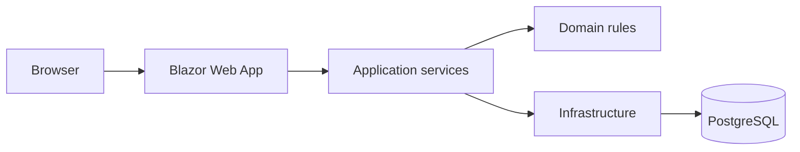

# Architecture

LocalEats is a modular monolith: one application with clear boundaries between its main responsibilities. This keeps development straightforward while allowing individual features to grow without placing business rules inside page components.

## Request flow

Blazor pages display information and collect user input. Application services check identity, permissions and business requirements. Domain rules define valid behavior, such as permitted order-status transitions. Infrastructure handles Entity Framework Core queries, database transactions and Identity persistence.

## Main data relationships

- A restaurant has menu categories and menu items.
- A manager has a persisted restaurant assignment.
- An order belongs to a restaurant and may be linked to a customer account.
- Order items retain the name, quantity and price recorded at purchase.
- Audit records identify the actor, affected order, restaurant, status change and time.

## Access control

A role determines which area a user can enter. Resource checks then determine which restaurant or order they can access. A Manager role alone does not grant access to every restaurant.

Database queries repeat the relevant ownership conditions before returning or updating records. Browser-supplied IDs do not establish permission.

## Order reliability

The server checks current prices and item availability during checkout. An order header and its purchased items are saved transactionally. A request identifier helps prevent duplicate orders when a submission is repeated.

Order processing follows a defined transition graph. Updates include the expected current status, so two requests cannot both advance the same observed state. A successful status update and its audit record are committed in one transaction. If the audit insert fails, the status update rolls back.

Audit metadata contains the previous and new status. Customer contact details and free-text rejection reasons are not duplicated into that metadata.

## Current boundaries

The application currently supports cash-on-delivery and pay-at-pickup records. It does not process online payments or provide live delivery tracking. Shared session storage, hosting, production monitoring and deployment are later decisions.
